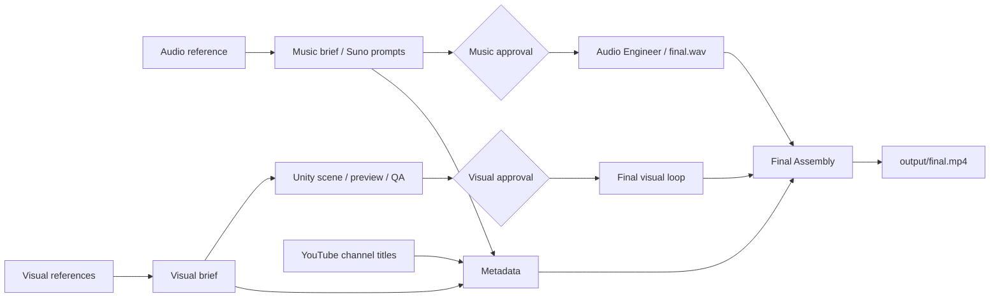

# Liminal Factory — macOS MVP

Локальное приложение Tauri 2 / React / TypeScript с Python sidecar, SQLite, параллельным DAG и ручными утверждениями музыки и визуальной сцены. Полный производственный запуск требует внешних CLI, авторизованного AI-провайдера, лицензированного Unity с графическим устройством.

## Возможности и статус

| Часть приложения | Что реализовано |
| --- | --- |
| Desktop UI | Dashboard, New Episode, Episodes, Agents, Settings; нативные файловые диалоги |
| Orchestrator | Асинхронный DAG, параллельные ветки, лимит задач, retry/cancel, SQLite и логи |
| Reference intelligence | Разрешённое извлечение аудиофрагмента, измеримый аудиоанализ, image-capable agents, yt-dlp channel pagination/cache |
| Музыка | Suno prompts, ручной импорт, прослушивание, approval с SHA-256, три режима продления |
| Визуал | Агентский JSON scene spec, процедурная Unity-сцена, batch preview/render и Visual QA adapter |
| Экспорт | WAV заданной длительности; H.264/AAC MP4 с проверками FFprobe и контрольным декодированием |
| Упаковка | Tauri `.app` со встроенным Python sidecar; конфигурация `.dmg` |

Проверены запуск `.app` на Apple Silicon, создание эпизода через GUI, восстановление после перезапуска, 192 Python-тестов и 27 тестов интерфейса, WAV ровно на 3600 секунд и завершённый эпизод с Unity-записью на 180 секунд. Правки финала и сохранение нескольких версий проверены на отдельном тестовом эпизоде; реальный GPT-6.1 Sol Medium вернул валидный план правки. Результаты и ограничения перечислены в [VERIFICATION.md](VERIFICATION.md), план — в [IMPLEMENTATION_PLAN.md](IMPLEMENTATION_PLAN.md).

## Требования

| Компонент | Для чего нужен | Входит в готовую `.app` |
| --- | --- | --- |
| macOS | Нативный UI, Keychain, запуск Unity | Целевая ОС |
| Node.js 20.19+ и npm | Разработка UI и сборка | Не нужен конечному пользователю |
| Rust stable / Cargo | Сборка Tauri | Не нужен конечному пользователю |
| Python 3.11+ | Разработка backend, PyInstaller | Да, в составе sidecar |
| Xcode Command Line Tools | Компиляция нативной части | Не нужен для запуска готовой сборки |
| FFmpeg / FFprobe | Подготовка аудио, кодирование и проверка видео | Нет |
| yt-dlp | Получение разрешённого аудиофрагмента | Нет |
| Совместимый Herdr TUI CLI | Workspace/pane/agent orchestration | Нет |
| Codex CLI или Antigravity Client + запущенный через него agy | Исполнение AI-задач; требуется авторизация | Нет |
| Unity Editor | Создание сцен и batch render; требуется активная лицензия | Нет |
| yt-dlp channel extractor | Публичные заголовки канала с пагинацией | API key не требуется |
| Suno и музыкальный WAV/MP3 | Ручная генерация и импорт музыки | Нет |

Проверенная архитектура — Apple Silicon. Поддержка Intel и других версий macOS требует отдельной сборки и проверки; значение minimumSystemVersion в Tauri само по себе не подтверждает совместимость всех Python/media-зависимостей.

## Быстрый запуск разработки

Все команды выполняйте в Terminal из корня клонированного репозитория. Склонируйте репозиторий:

```bash
git clone https://github.com/IFraimG/liminal-factory.git
cd liminal-factory
```

Проверьте инструменты:

```bash
xcode-select -p
node --version
npm --version
python3 --version
rustc --version
cargo --version
```

Если Command Line Tools отсутствуют:

```bash
xcode-select --install
```

Node.js установите с [nodejs.org](https://nodejs.org/en/download), Python — с [python.org](https://www.python.org/downloads/macos/). Для Rust следуйте [официальной инструкции rustup](https://rustup.rs/). Подробные требования macOS описаны в [документации Tauri](https://v2.tauri.app/start/prerequisites/#macos). Убедитесь, что именно `python3` в PATH имеет версию 3.11 или новее, затем откройте новый Terminal.

Установите JavaScript-зависимости и запустите приложение:

```bash
npm install
npm run tauri dev
```

Первый запуск автоматически создаёт `.venv`, устанавливает Python-зависимости и собирает sidecar. Кэш npm находится внутри `work/`, а не в домашнем каталоге. На машине разработки Rust был установлен в `work/cargo` и `work/rustup`; wrapper использует его, если он существует. На другой машине установите Rust стандартным способом с официального rustup.rs.

```bash
npm run build               # TypeScript и production frontend
npm test                    # реальные проверки backend и коротких FFmpeg media
npm run tauri build         # Python sidecar + release .app и .dmg
```

Для воспроизводимой установки JavaScript-зависимостей после клонирования можно использовать `npm ci` вместо `npm install`.

Для backend-тестов без предварительного GUI-запуска сначала подготовьте Python-окружение:

```bash
python3 scripts/bootstrap.py
npm test
```

`npm run dev` запускает только Vite. Для полноценного приложения используйте `npm run tauri dev`: он запускает native host и Python backend, необходимые для API и файловых диалогов.

## Сборка приложения

```bash
# Полная сборка .app и .dmg
npm run tauri build

# Сборка только .app, если DMG недоступен в текущей среде
npm run tauri build -- --bundles app
```

Ожидаемые результаты:

```text
src-tauri/target/release/bundle/macos/Liminal Factory.app
src-tauri/target/release/bundle/dmg/Liminal Factory_0.1.0_aarch64.dmg
```

Имя/архитектура DMG зависит от машины сборки. Для запуска откройте `Liminal Factory.app` через Finder. При распространении передавайте весь `.app`, сохраняя его внутренние папки и symlink; нельзя переносить один исполняемый файл из `Contents/MacOS`.

Сборки находятся в `src-tauri/target/release/bundle/`. Python включён в приложение через PyInstaller **onedir**, включая numpy, soundfile и нативные библиотеки. Он находится в `Contents/Resources/backend/`; отдельный Python конечному пользователю не нужен. One-file намеренно не используется: его semaphore/extraction механизм запрещён в среде разработки. FFmpeg, FFprobe, yt-dlp, Herdr, Codex/Antigravity Client и Unity являются проверяемыми внешними prerequisite и в приложение не включены.

## Настройка внешних компонентов

### FFmpeg и yt-dlp

Установите [FFmpeg](https://ffmpeg.org/download.html) и [yt-dlp](https://github.com/yt-dlp/yt-dlp#installation) по их официальным инструкциям. Убедитесь, что доступны три команды:

```bash
ffmpeg -version
ffprobe -version
yt-dlp --version
```

В Settings → External Tools задаются пути именно к executable, а не к папке. Если программа работает в Terminal, но не обнаруживается в `.app`, укажите абсолютный путь из `command -v ffmpeg`, `command -v ffprobe` и `command -v yt-dlp`.

#### Cookies из Google Chrome

Если вы разрешаете использовать свой браузерный сеанс, в **Settings → YouTube download session** включите **Use cookies from Google Chrome for permitted YouTube downloads**, затем сохраните настройки. Это не снимает требование согласия на получение самого аудиофрагмента в New Episode.

Пустое поле Chrome profile folder соответствует `--cookies-from-browser chrome`: yt-dlp выбирает наиболее недавно использованный профиль. Для явного выбора можно указать имя каталога `Default` или `Profile 1`. Пути и дополнительные browser/keyring options в этом поле не принимаются.

Приложение передаёт yt-dlp только имя браузера/профиля. Cookies читаются самим yt-dlp; `--cookies FILE` не используется, cookie jar не экспортируется. `--ignore-config` исключает неожиданные параметры из внешних конфигов yt-dlp, а чувствительные HTTP-заголовки и query-параметры URL удаляются из download.log и сообщений об ошибках. Chrome и его профиль приложение не изменяет. На текущей машине команда с cookies Chrome успешно получила метаданные выбранного видео; загрузка полного файла этим тестом не выполнялась.

См. [официальную FAQ yt-dlp](https://github.com/yt-dlp/yt-dlp/wiki/FAQ#how-do-i-pass-cookies-to-yt-dlp).

### Herdr TUI

Установка через уже настроенный Homebrew согласно [официальной инструкции Herdr](https://herdr.dev/tui/docs/install/):

```bash
brew install herdr
herdr --version
herdr agent start --help
```

Если используете другой способ установки, следуйте официальной инструкции. До запуска production откройте Herdr либо запустите его server в отдельном Terminal:

```bash
herdr server
```

Оставьте его запущенным и из другого Terminal проверьте:

```bash
herdr status
herdr agent list
```

Старый/несовместимый CLI не подходит только на основании похожего названия. Liminal Factory проверяет доступные команды перед запуском.

### AI-провайдер

Установите и авторизуйте Codex CLI по документации его поставщика либо подготовьте Client-сеанс по инструкции ниже. Для Codex проверьте `codex --version` и доступность модели. Gemini/agy напрямую приложение не запускает. В приложении задайте agent kind, default model и при необходимости model mapping для отдельных задач. Флажок vision включайте только после проверки, что агент действительно умеет открывать изображения с диска.

### Antigravity Client: только предварительно запущенный CLI

Для вашего сценария добавлен отдельный режим **Antigravity Client · existing Herdr CLI**. Он работает с установленным Herdr Core CLI `hc` (проверен API/schema версии 0.1.18), а не пытается выдать его за Herdr TUI CLI. Для режима Codex по-прежнему нужен документированный TUI adapter.

1. В Settings → AI provider выберите **Antigravity Client · existing Herdr CLI**.
2. Проверьте `hc` и `agy` executable paths. Автопоиск учитывает `~/.local/bin/hc` и `~/.local/bin/agy`. Production orchestrator использует путь `agy` только для сверки процесса. Запуск CLI выполняет Client через описанный ниже внешний launcher.
3. Укажите локальный proxy port Client (по умолчанию `8047`) и время ожидания вашего запуска CLI (по умолчанию 300 секунд). Нажмите **Save settings**.
4. Нажмите **Open Client / wait for CLI**. Если при Start Production сеанс ещё не подключён, Liminal Factory также открывает `/Applications/Antigravity Client.app` и переводит AI-задачу в **Waiting for Client**.
5. Настройте внешний launcher, если Client по умолчанию открывает отдельный Terminal (инструкция ниже), затем самостоятельно нажмите штатную кнопку **CLI** в Antigravity Client. Выберите нужную модель, например доступный вам вариант Gemini 4 Argon, внутри этого CLI. Поля per-task model mapping в Liminal Factory в этом режиме отключены: уже работающий сеанс сохраняет вашу модель.
6. Единственная свободная панель, созданная внешним Liminal launcher через кнопку Client, подключается автоматически. Если таких панелей несколько или метки launcher нет: в **Antigravity Client session** выберите нужную idle-панель, подтвердите запуск через Client и нажмите **Connect existing CLI**.
7. Оставьте эту панель выделенной для задач Liminal Factory. При необходимости подтвердите доступ агента к рабочей папке эпизода в самом CLI; приложение не принимает permission/auth dialogs за вас.

При подключении проверяются foreground executable `agy`, PID, момент создания терминала и idle-состояние; перед отправкой проверяется текущее состояние. Для `idle` используется атомарный `hc send --if idle`. После завершённой задачи CLI может оставаться в `done`; в этом случае используется штатный send Core, который также отказывается печатать в blocked-диалоги. Панель должна оставаться выделенной для Liminal Factory. Для обычных панелей способ первоначального запуска подтверждаете вы — приложение не заявляет, что может самостоятельно доказать происхождение произвольного уже запущенного процесса. Проверки процесса защищают от незаметной замены панели после вашего подтверждения.

Production orchestrator в этом режиме **не запускает `gemini`/`agy`, не выполняет `hc run`/`agent start` и не создаёт pane**. Его adapter использует только get/list/send/read/interrupt существующего терминала. Запуск Client — штатный `open -a` macOS. Bundle Client и файлы его credentials не редактируются. Единственное согласованное изменение пользовательских настроек Client — путь CLI на внешний launcher. `/health` на `127.0.0.1` проверяет готовность локального proxy.

Один подключённый CLI обрабатывает AI-задачи последовательно, чтобы параллельные промпты не перемешивались. Независимые задачи анализа/медиа продолжают использовать DAG concurrency. Успех требует нового валидного JSON-артефакта и завершённого turn; один `idle`/`done` не подтверждает результат. Состояние `blocked` во время задачи означает ожидание вашего решения в Herdr, а не немедленную ошибку: приложение ждёт в пределах timeout и пишет это в лог, не отвечая на диалог.

Если proxy пропал, pane завершился или PID/terminal identity изменились, новые промпты блокируются. Прямого fallback нет. Cancel может прервать только текущий промпт, переданный этим adapter в тот же подтверждённый процесс; пользовательская панель не закрывается и CLI не перезапускается. После перезапуска Liminal Factory единственная свободная панель нашего launcher подключается автоматически с новым проверенным fingerprint. Новый CLI из того же launcher тоже обнаруживается автоматически. Для немаркированных или нескольких панелей нужен ручной выбор. Автоподключение проверяет метки launcher, исходный argv, совпадение PID терминала с foreground CLI, рабочую директорию и proxy; старый PID не даёт права управлять новым процессом. Старое значение provider `gemini` также направляется в этот защищённый режим.

При истечении ожидания AI-задача получает Failed с инструкцией: запустите CLI через Client, подключите панель, затем Retry Task. Без подтверждения панели никакие задания в неё не отправляются.

#### Если Client открывает CLI в обычном Terminal

Обычный Terminal-сеанс нельзя подключить к Herdr Core задним числом. Для этого случая предусмотрен отдельный **Client → Herdr launcher** вне bundle Client. Он вызывается штатной кнопкой CLI самого Client и создаёт агентский терминал через документированный в установленном `hc schema` JSON-RPC метод `terminal.run`.

Сначала соберите актуальную `.app`, затем создайте файл launcher:

```bash
npm run tauri build -- --bundles app
.venv/bin/python scripts/create_client_launcher.py \
  --output "$HOME/Library/Application Support/Liminal Factory/launchers/antigravity-client-herdr" \
  --backend "$PWD/src-tauri/target/release/bundle/macos/Liminal Factory.app/Contents/Resources/backend/liminal-backend" \
  --cwd "$HOME/Library/Application Support/Liminal Factory/episodes"
```

Файл launcher содержит только пути и параметры запуска, имеет права `0700`, использует упакованный Python sidecar и не требует системного Python при обычном запуске. `scripts/create_client_launcher.py` нужен только для первоначальной генерации/перенастройки файла из исходников. Укажите свою рабочую папку в `--cwd`, если она отличается от значения по умолчанию. Не выбирайте сам launcher в качестве оригинального `agy`.

В **Antigravity Client → Settings → Antigravity CLI (agy) → Custom Executable Path** укажите созданный файл и нажмите **Done**. Другие поля Client менять не требуется. После этого кнопка **CLI** запускает следующую цепочку:

```text
Antigravity Client → внешний launcher → Herdr Core → оригинальный agy
                                              ↓
                                Liminal Factory подключается к готовому сеансу
```

Launcher проверяет локальный proxy, пересылает необходимые унаследованные переменные провайдера в локальный Herdr через **stdin JSON-RPC** и не записывает их на диск, в CLI-аргументы или логи. Несвязанные переменные вроде `SSH_AUTH_SOCK` и `LIMINAL_TOKEN` не пересылаются. Поддерживаются только интерактивные startup-опции `--model`/`--effort`; secret-bearing settings, `--print` и permission-bypass flags отклоняются. Сам orchestrator этот launcher не вызывает: он только открывает Client и ждёт вашего запуска CLI.

Launcher напечатает адрес созданного терминала, например `t2`. Если Herdr GUI ещё не показывает его, в существующей панели можно открыть его командой:

```bash
~/.local/bin/hc attach t2
```

Рассмотрите стартовый trust/permission-запрос CLI самостоятельно. После его завершения панель должна сообщать `idle`; Liminal Factory автоматически подключит единственную панель нашего launcher. При неоднозначности выберите её в Settings. Модель выбирается внутри CLI. Проверка настройки не отправляет модельных заданий и не генерирует контент.

Для возврата к прежнему поведению очистите только поле **Custom Executable Path** в Client. При переносе `.app`, рабочей папки или launcher пересоздайте launcher с актуальными путями и обновите это поле. В локально настроенной среде launcher находится в папке `outputs/` проекта и ссылается на собранную здесь `.app`; не перемещайте эти файлы без перенастройки.

#### Проверка vision в настроенной среде

Текущий **Gemini 4 Argon (Medium)** в Client-сеансе реально прочитал синтетический PNG через `read_file`: случайный шестисимвольный код и две разные фигуры распознаны правильно. Пользовательские референсы для проверки не использовались. После этой проверки в локальных Settings включено и сохранено **My selected model/agent can inspect local image files**. Это подтверждает конкретный проверенный CLI/модель; после смены модели её image capability нужно проверить заново.

### Данные YouTube без API key

Google Cloud и YouTube Data API key не нужны. Заголовки публичных видео, Shorts и трансляций канала извлекает yt-dlp: корневой URL канала, `--flat-playlist --skip-download --dump-single-json`, автоматическое чтение страниц продолжения. Аудио скачивается отдельной задачей и не зависит от сбора заголовков.

Settings → YouTube download session позволяет использовать cookies установленного Google Chrome для скачивания и чтения канала. Cookies не экспортируются в файл. Пустое поле выбирает `profile.last_used` из настроек Chrome; если определить его нельзя, приложение просит явно указать профиль вместо использования другой сессии. Для фиксированной сессии задайте папку профиля, например `Default` или `Profile 1`. Содержимое авторизованной сессии остаётся у yt-dlp.

Кэш публичных заголовков задаётся в Settings → Channel cache (hours); 0 отключает повторное использование. Одинаковые video ID исключаются, исходный текст заголовков сохраняется. Закрытые и недоступные публикации не гарантируются. Ошибка сети или извлечения останавливает задачу канала с диагностикой; неполный результат не записывается как успешный кэш. Ошибка канала не блокирует независимую задачу загрузки аудио. Ранее сохранённый API key не используется и не требуется.

### Unity

Установите Unity Editor через [Unity Hub](https://unity.com/download), активируйте подходящую лицензию и откройте Editor хотя бы один раз, чтобы завершить настройку. На машине разработки установлен Unity 6000.6.5f1; другие версии требуют проверки.

В Settings укажите путь вида:

```text
/Applications/Unity/Hub/Editor/<VERSION>/Unity.app/Contents/MacOS/Unity
```

Test Connection подтверждает наличие executable. Работоспособность лицензии и графики проверяется настоящим batch render. При лицензировании/compile/graphics errors задача будет Failed; смотрите `unity-create.log`, `unity-preview.log` и `unity-render.log` внутри папки эпизода.

### Первоначальная настройка в приложении


1. Откройте Settings, выберите отдельную директорию проектов и сохраните настройки.
2. Настройте пути внешних инструментов и нажмите Test Connection для каждого. Unity автоматически ищется в `/Applications/Unity/Hub/Editor/*/Unity.app/Contents/MacOS/Unity`.
3. Для режима Codex установите **Herdr TUI CLI** из официальной документации. Наличие приложения `Herdr.app` либо другого исполняемого файла `hc` не подтверждает совместимость. Требуются команды `workspace create`, `agent start --kind … --pane …`, `agent prompt/get/read/send-keys` и `pane close`. Запустите Herdr server самостоятельно согласно его документации. Приложение не перезапускает чужие сессии.
4. Для режима Codex авторизуйте CLI и задайте модель; при необходимости переопределите модель для отдельных задач. Для Antigravity следуйте инструкции подключения существующей панели выше; приложение не запускает Gemini напрямую.
5. Убедитесь, что выбранный agent/model действительно умеет просматривать локальные изображения, и включите соответствующий флажок. Без этого visual analysis недоступен и production не начнётся.
6. YouTube API key не требуется. При необходимости включите использование Google Chrome cookies для yt-dlp в Settings → YouTube download session.
7. Активируйте Unity Personal/Pro в Unity Hub. Нужен работающий графический рендеринг. `-nographics` не используется и не подходит для захвата кадров.

## Производство эпизода

- New Episode: HTTPS YouTube video URL, начало MM:SS/HH:MM:SS, длительность анализа, согласие на получение фрагмента, одно или несколько изображений, канал `/@handle` либо `/channel/UC…`.
- Изображения поддерживают drag and drop, миниатюры, порядок и удаление. Они копируются в workspace. После начала анализа references блокируются.
- Выберите стиль, длительность, FPS, разрешение, audio mode, длину визуальной петли и при желании директорию экспорта. Save episode draft сохраняет эпизод без запуска внешних задач. Start Production проверяет зависимости и запускает DAG.
- Audio Reference и Visual Reference одновременно с Channel Reference выполняют независимые работы. Semaphore ограничивает общее число активных задач; это также ограничивает число агентов.
- Audio analysis использует фактические RMS, FFT spectral centroid, динамический диапазон и оценку темпа по autocorrelation. Это **не** семантическое прослушивание моделью; для ambient оценка темпа может быть ненадёжной. Ограничения записываются в JSON.
- Music Agent создаёт оригинальный бриф и несколько Suno prompts. Их можно редактировать, сохранять и копировать. Open Suno открывает официальный сайт. Генерируйте музыку вручную и импортируйте WAV/MP3. Автоматизации браузера Suno нет.
- Approve music фиксирует SHA-256 музыки и брифа. Следующая задача автоматически собирает WAV заданной длительности.
- Visual Agent реально просматривает изображения через настроенный CLI. Unity Agent выбирает ограниченный JSON scene spec: палитру, туман, камеру, шаг колонн. Фиксированный C# template создаёт terrain, архитектуру, материалы, свет, fog, камеру и периодическое движение. Произвольный C# от модели не исполняется.
- Unity создаёт preview; image-capable agent сравнивает первый кадр с references и сохраняет Visual QA. После Approve visual сцена рендерит петлю в целевом разрешении, затем FFmpeg собирает MP4.
- Metadata ждёт музыкального и визуального брифов, получает все доступные публичные заголовки через yt-dlp с автоматической пагинацией и кэшем, создаёт пять уникальных заголовков, описание и хэштеги. Проверяется формат `#tag, #tag` и отсутствие дословных совпадений с источниками. Прогноз эффективности не заявляется.
- Final Assembly ждёт все ветки. Результат — `output/final.mp4` и `output/metadata.json`. Дополнительный экспорт создаёт уникальную папку `liminal-<episode-id>` без перезаписи существующей.

В Episode Details доступны реальные статусы, время задач, structured results, логи, playable audio/video, файлы, Retry Task, Cancel Task, Approve, Request Changes и Open Output Folder. Request Changes передаёт текст агенту и инвалидирует зависимые задачи, включая metadata/final assembly. Музыку можно удалить и импортировать заново до утверждения.

## Аудио и видео

Seamless Loop ищет тихие окна у границ, делает перекрытие tail/head и записывает повторяемый cycle на диск. Финальный WAV не создаётся целиком в памяти. FFmpeg повторяет его до нужной длительности; two-pass loudnorm целится в -18 LUFS / -1.5 dBTP. Финальный проход измеряет true peak, sample peak и точную длительность. Слишком тихий/некорректный источник отклоняется.

Ambient Evolution добавляет отдельную детерминированную плавную амплитудную вариацию до 2.5% с периодом 125 секунд. Multi-track сначала сшивает несколько утверждённых файлов через crossfade и затем строит петлю. Это минимальные, предсказуемые преобразования; сложной генеративной аранжировки в MVP нет.

Unity снимает кадры в batchmode через Camera.Render/RenderTexture. Все движения определяются фазой одного периода и не накапливают время. C# сохраняет сцену `unity-project/Assets/Liminal.unity`, которую можно открыть в Editor. Требуется лицензия и графический device; ошибка возвращается явно с Unity log.

FFmpeg повторяет короткий визуальный цикл, кодирует H.264/AAC с требуемым FPS/разрешением, затем FFprobe проверяет streams/codecs/duration/resolution/FPS, а FFmpeg декодирует начало, середину и конец файла. Час уникальных кадров не рендерится.

## Как выполняется DAG



Причина отклонения Start Production отображается в интерфейсе и сохраняется в Execution log как `Start blocked`. Ошибки API, включая 400/401/500, получают CORS-заголовки внешней ASGI-обёрткой, чтобы WebKit мог прочитать текст. При настоящем сетевом сбое frontend сообщает о недоступности локального backend и не повторяет запрос автоматически.

Failed-задача блокирует зависимых потребителей. Retry повторяет выбранную неуспешную/отменённую задачу после успешного завершения её dependencies. Cancel останавливает текущую process group либо созданный агентский pane. Approve доступен только в Waiting for Approval. Request Changes сбрасывает зависимые результаты и сохраняет текст правок для следующей попытки агента.

## Надёжность и безопасность

- Loopback HTTP на случайном порту; два UUID формируют bearer token. Токен передаётся sidecar через environment, а webview — через единственную Rust bootstrap command. CORS/CSP ограничивают источники. Media range requests поддерживаются FileResponse; для тегов audio/video используется token URL, access logs выключены.
- В JavaScript нет shell/filesystem capabilities. Нативным диалогам разрешён только выбор файлов/каталогов. Rust-команда открытия сайта фиксирована на Suno, backend открывает только папку существующего эпизода.
- subprocess вызывается списком аргументов без shell; процессы имеют отдельную process group, timeout и рекурсивную отмену. Секреты не передаются в CLI аргументах и не сохраняются в логах.
- Строгий HTTPS/YouTube whitelist, защита от path traversal и symlink escape, проверка содержимого изображений/аудио, ограничения импорта 70 MB и 40 MP.
- Reference data не считаются инструкциями. Модели получают явную политику; код сцены фиксирован, их JSON проходит Pydantic validation. Автоматической публикации нет.
- SQL WAL хранит состояния, identity pane/agent, артефакты и structured logs. Backend lock исключает два orchestrator для одной data folder.
- После перезапуска прерванные локальные операции переходят в Failed с требованием Retry. Сохранённые identity принадлежащих приложению Herdr-агентов сверяются с CLI перед повтором. Пользовательский Client-сеанс после перезапуска не прерывается; свободная единственная панель Liminal launcher подключается автоматически, прочие панели требуют ручного выбора. Произвольный сохранённый PID не используется для kill. Если Herdr недоступен, интерфейс требует ручной проверки. Это безопасное восстановление к явному повтору, а не продолжение прерванного FFmpeg с середины.
- Каждая попытка агента имеет уникальный результат JSON. `idle`/`done` без валидного файла не считаются успехом. Approved-файлы повторно проверяются по SHA-256 перед обработкой/сборкой.
- Мок Herdr существует только как test dependency; production UI не может выбрать его.

## Данные

По умолчанию: `~/Library/Application Support/Liminal Factory/factory.sqlite3`; эпизоды находятся в подпапке `episodes/`. Путь проектов задаётся до создания первого эпизода. Смена root при существующих эпизодах блокируется, чтобы не терять связь с файлами. Для изолированной проверки можно перед запуском задать `LIMINAL_DATA="$PWD/work/runtime"`.

```text
backend/                  API, schemas, SQLite, DAG, adapters, media
src/                      React UI, typed API, navigation, styles
src-tauri/                native host, minimal capabilities, packaging
unity-template/           reproducible C# procedural scene
scripts/                  bootstrap, PyInstaller build, hour stress test
tests/                    security, DAG, API, Herdr contract, actual FFmpeg
IMPLEMENTATION_PLAN.md    implementation / validation checklist
VERIFICATION.md           observed checks and outstanding prerequisites
```

## Тестирование и диагностика

```bash
# Backend, DAG, API, безопасность и реальные короткие media-проверки
python3 scripts/bootstrap.py
npm test

# TypeScript и production frontend
npm run build

# Дополнительная реальная проверка часового WAV
.venv/bin/python scripts/verify_hour_audio.py
```

Часовой stress test использует синтетические тоны, создаёт временный WAV примерно на гигабайт в `work/hour-audio-test`, проверяет его и удаляет после успешного завершения. Это тест обработки, а не сгенерированная музыка и не полный production episode. FFmpeg должен быть доступен в PATH; без него media-тесты помечаются skipped, поэтому проверяйте итоговый отчёт pytest.

| Проблема | Что проверить |
| --- | --- |
| `cargo` / `rustc` not found | Rust установлен; новый Terminal загружает PATH; `cargo --version` работает |
| Python ниже 3.11 | Путь `command -v python3` и `python3 --version`; окружение создаётся этим интерпретатором |
| `.venv/bin/python` not found | Выполните `python3 scripts/bootstrap.py` из корня проекта |
| Start сообщает о поддержке изображений | Подтвердите image capability выбранного CLI/model в Settings только после проверки, что он действительно умеет открывать изображения с диска. До этого workflow не запускается |
| Backend is not connected | Открывайте приложение через Tauri, а не отдельную страницу Vite; изучите stderr Terminal |
| Backend did not initialize in 30 seconds | Убедитесь, что sidecar полностью упакован и доступна data folder; проверьте запуск из Terminal |
| Workspace already open | Закройте другой экземпляр, использующий ту же data folder; не удаляйте lock у работающего процесса |
| Herdr missing/incompatible | Проверьте TUI CLI, `herdr agent start --help`, server и абсолютный executable path |
| Waiting for Client | Нажмите CLI в Antigravity Client; выберите его idle-панель в Settings и подтвердите подключение. Client-файлы изменять не нужно |
| Agent blocked | Откройте его pane в Herdr, разберите запрос авторизации/доверия и повторите задачу; приложение не подтверждает диалоги за вас |
| Нет `music_brief.json` / structured result | Agent idle не означает успех: требуется валидный результат; проверьте agent log, модель и доступ к workspace |
| Ошибка извлечения канала yt-dlp | Проверьте публичный URL канала, сеть, актуальность yt-dlp и выбранный профиль Chrome |
| yt-dlp download error | URL, разрешение и доступность материала; при необходимости включите Chrome cookies и выберите профиль с доступом. Ошибки входа/ограничений не считаются успешной загрузкой |
| Visual analysis unavailable | Image-capable model/CLI, локальный просмотр файлов и флажок vision |
| Unity license/graphics error | Unity Hub license, первый ручной запуск Editor, работающая графическая среда; не добавляйте `-nographics` |
| Approved artifact changed | Файл изменён после approval; верните исходный результат или запросите изменения и утвердите повторно |
| Multi-track требует два файла | Импортируйте минимум два WAV/MP3 перед Approve music |
| `hdiutil: Device not configured` | Соберите `.app` через `npm run tauri build -- --bundles app`; DMG собирайте в macOS-среде с доступной disk image subsystem |
| Не хватает места | WAV, Unity project, PNG-кадры и итоговое видео хранятся на диске; выберите рабочую папку с достаточным свободным объёмом |

Для изолированной сессии разработки:

```bash
LIMINAL_DATA="$PWD/work/local-session" npm run tauri dev
```

Используйте другой LIMINAL_DATA, если production `.app` уже открыта: один data folder обслуживается одним backend. Перед backup закройте приложение и скопируйте целиком data folder вместе с папкой эпизодов; ключи остаются в Keychain.

## Что хранится в Git

В репозиторий входят исходники, lock-файлы npm/Cargo, конфигурация Tauri, Unity C# template, тесты и документация. `.venv`, `node_modules`, `work`, `outputs`, `src-tauri/target`, упакованный sidecar, локальные базы и сгенерированные медиа не нужны для исходников и не публикуются. Код автоматически не открывает доступ к проектным файлам другим пользователям и не публикует готовые видео.

## Ограничения текущей версии

Нет гарантий semantic audio understanding, расширенной генерации Unity-кода, автоматического Suno, публикации на YouTube, частичного resume render, агента без авторизации или работы без внешних инструментов. Appearance фиксирован в dark mode; output defaults задаются в форме эпизода. Режим preview — та же процедура с меньшим разрешением. Модель может предложить visual QA правки, но их применение требует Request Changes и нового scene spec. Изображения обрабатываются внешним модельным провайдером только при явном запуске производства.

Локальная сборка не равна production distribution. Для распространения нужны Apple Developer signing/notarization, проверка лицензий внешних компонентов и тесты на целевых Intel/Apple Silicon машинах. Текущая сборка предназначена для этой Apple Silicon macOS-среды.

## Официальная документация

- [Herdr agent automation](https://herdr.dev/tui/docs/agent-automation/) и [CLI reference](https://herdr.dev/tui/docs/cli-reference/)
- [Tauri 2 — external binaries](https://v2.tauri.app/develop/sidecar/) и [resources](https://v2.tauri.app/develop/resources/)
- [YouTube playlistItems.list](https://developers.google.com/youtube/data/reference/rest/v3/playlistItems/list)

### YouTube просит подтвердить, что вы не бот

Если лог уже содержит `Extracting cookies from chrome`, флаг `--cookies-from-browser` включён. Проверьте **Settings → Chrome profile folder**: при нескольких профилях требуется профиль, где открыто видео и выполнен вход в YouTube. Пустое поле использует последний выбранный профиль Chrome, явное значение фиксирует сессию. Сохраните настройки и нажмите **Retry Task** для Audio Reference. Изменение настроек требует завершить либо отменить текущие выполняющиеся/ожидающие задачи; затем отменённые задачи можно повторить.

HTTP 429 означает ограничение запросов со стороны YouTube. Правильные cookies не гарантируют снятия такого ограничения: не повторяйте загрузку подряд при сохраняющейся ошибке, проверьте доступ к видео в том же Chrome. [Официальная инструкция yt-dlp по cookies](https://github.com/yt-dlp/yt-dlp/wiki/Extractors#exporting-youtube-cookies).

## Подготовка формы Suno без генерации

В Music studio сохранены импорт MP3/WAV и ручное утверждение музыки. Дополнительно, после завершения Music Brief, доступна **Prepare form in Chrome**:

1. Установите локальное расширение **Liminal Suno Prep** в том Chrome-профиле, где выполнен вход в Suno: `chrome://extensions` → Developer mode → Load unpacked → папка `browser-extension/suno-prep` из исходников или `outputs/Suno-Prep-Chrome` из комплекта. [Исходный код и инструкция расширения](browser-extension/suno-prep/README.md).
2. В Suno Account settings проверьте email. Введите его в Music studio → Suno account email и выберите один из промптов агента. Адрес сохраняется только локально в приложении.
3. Нажмите **Prepare form in Chrome**. Расширение сверит Email на странице аккаунта, вернётся в Create и заполнит Styles и Song Title. Lyrics останется пустым для instrumental. Дождитесь зелёного баннера Prepared и самостоятельно проверьте форму.
4. **Create нажимаете вы.** Автоматическая генерация, публикация и скачивание в этом режиме отсутствуют. После создания можно самостоятельно импортировать MP3/WAV в приложение; без локальной музыки Audio Engineer и финальная сборка ожидают импорта и утверждения.

Расширение имеет доступ только к страницам `https://suno.com/*`. Оно не читает cookies, не получает токен локального backend и не вызывает внутренний API Suno. Пакет черновика передаётся во fragment ссылки и действует 30 минут; временный sessionStorage очищается по завершении или ошибке. Если аккаунт не совпал, форма уже содержит другой черновик, Lyrics заполнен или интерфейс не распознан — заполнение прекращается с пояснением. Поддерживаются английские подписи текущей формы; при изменении Suno может потребоваться обновление расширения.

Проверки расширения: `npm run test:browser`. В тестах проверяются запрет отправки формы, ошибочный аккаунт, сохранность существующего черновика, неоднозначные поля, истечение ссылки и минимальные разрешения.

### Обязательные More Options Suno

Новый Music Brief включает `suno_options` с исключениями стилей, Weirdness, Style Influence, Variety, длительностью, Max Mode, Personalize Off и отсутствием вокального пола для instrumental. Агент обосновывает выбор в `rationale` на основе брифа и технического анализа. Числовые настройки генерации не выдаются за измеренные характеристики референса. В Music studio значения и обоснование показаны перед подготовкой.

У старого брифа без этих полей кнопка подготовки отключена. **Ask agent for More Options** запрашивает дополнение существующего брифа с сохранением текста и промптов; музыкальная ветка и зависимые метаданные проходят обычное повторное рассмотрение. При ручном редактировании промптов сохранённые More Options сохраняются. Расширение версии 0.2 проверяет все значения после заполнения; без успешной проверки раздела More Options зелёного Prepared не будет.

### Паузы CLI, очередь и поздние результаты

- `Waiting for Permission`: рассмотрите запрос в указанной панели Herdr. 30-минутный лимит активной работы агента и общий 4-часовой лимит активной работы задачи приостановлены на время ожидания. Разрешения не подтверждаются автоматически.
- `Waiting for CLI`: задача стоит в очереди к общему CLI или ждёт завершения его текущей работы. Промпт этой задачи ещё не отправлен. Отмена ожидающей задачи не прерывает текущую.
- Для Failed Metadata доступно **Recover saved result**. Восстановление использует только файл с UUID, записанным в identity этой задачи, и проверяет исходный CLI, завершённый ход, время файла, схему JSON, зависимости/снимки входов и отсутствие копий заголовков. После принятия записываются контрольные суммы. Повторный вызов модели не нужен. Если исходный CLI завершён или входы изменились, автоматическое принятие запрещено.
- Новый Unity Preview сохраняет контрольные суммы готового видео, кадра для QA, сцены и исходных визуальных данных перед визуальной проверкой. Retry при неизменном checkpoint повторяет только QA. Изменённые файлы требуют нового рендера. Старые задачи без checkpoint проходят обычный повторный запуск.


### Unity revisions, Kimi and full recording

`Request Changes` opens an in-app form. Submit the desired geometry, materials and camera changes; the preview and downstream visual approval/recording are invalidated, while approved music is kept. Preview URLs change with the artifact modification time. Scene design now explicitly chooses an enclosed subway car or corridor and a bounded camera pose; it cannot represent every possible reference. The subway builder supports transverse high-backed seat bays or longitudinal benches, with solid walls/ceiling, inset opaque windows, rails, hanging rings, ceiling lights and an optional stylized seated figure. Generated materials and wear textures are saved as Unity assets.

Kimi uses a dedicated **existing** Herdr Core session. Launch it in the episodes directory (replace paths if your working directory differs):

```sh
hc run --bg --no-parent --no-notify --outlive-parent --cwd "$HOME/Library/Application Support/Liminal Factory/episodes" --label liminal_factory=kimi-session -- "$HOME/.kimi-code/bin/kimi" --model kimi-code/k3.1-pro
```

To view that session **inside Herdr**, run `hc attach t11` in a shell panel inside Herdr, replacing `t11` with the address returned by `hc run`. Running `hc attach` in macOS Terminal shows the same live session in Terminal. It does not start another Kimi process. Keep the dedicated session reserved for the application; resolve its trust/permission dialogs yourself. A shell running `hc attach` is not accepted as the actual Kimi process. Exactly one session with the marker, expected directory and model must exist for automatic discovery. Model reasoning uses your Kimi configuration; on the verified installation `kimi-code/k3.1-pro` supports low/high/max and defaults to high.

Every executable step has its own saved agent order, editable in its episode. Exactly 5% remaining is eligible; known lower values are skipped. Unknown Argon quota is explicitly allowed by user policy, while unknown GPT/Kimi quotas are skipped. The router chooses the first eligible agent in that order, not the one with the highest balance. Codex reads account limits through its official app-server protocol; no inference request is made by that quota read. Argon/Kimi live self-quota telemetry is not connected: enter a percentage you verified in the provider interface under **Agent balances**. Manual values are labeled, expire after 15 minutes, and are not a live measurement. A live Codex result takes precedence over its manual fallback. Unknown/expired Argon quota remains allowed without inventing a percentage; unknown GPT/Kimi quotas are ineligible. If none qualify, the task enters **Waiting for quota** without sending a prompt and resumes when a valid balance becomes available. This replaces the earlier unconditional Kimi fallback for unknown primary balances. Account quota is not treated as remaining context tokens. Client contents/settings and authentication credentials remain untouched.

In the episode's **Unity recording** section manually enter minutes and save. This sets the episode duration too, so audio is rebuilt for the same length. Once the visual is approved, the selected agent returns a recording plan; the app rejects changes to the entered duration, resolution, frame rate or approved camera choice. Unity renders every frame for the entered duration into FFmpeg through a bounded RGB buffer. It stores `visual-recording.mp4`, rather than thousands of full-resolution PNGs or extending a short clip with `-stream_loop`. The final assembly verifies duration and joins the recorded video with the audio. Keep Unity licensed and allow its graphics device. Long 4K captures may take substantial time; the renderer has a finite safety timeout. A manually entered duration and visual approval are required before recording starts.


### Per-step agent priorities and workflow graph

Open an episode. The **Production workflow** graph shows Music, Unity and Metadata branches and their actual cross-branch dependencies, including the three inputs to final assembly. Click a node to open its details. Status and agent order appear on each node; dashed nodes are your approval gates. The graph scrolls horizontally on smaller windows.

For an executable step, use **Agent priority · this step**, move GPT/Codex, Gemini/Argon and Kimi up/down, then click **Save agent priority**. Each agent appears exactly once. The order is saved per episode and step, survives restarts, retry and Request Changes, and does not reset existing results. The next invocation uses it. All default orders place Argon before Kimi, including recording setup. Explicit per-step orders, including a manually chosen Kimi-first order, are preserved. The global provider setting supplies defaults for steps you have not configured.

The editor is locked while a step is Running, Waiting for quota, Waiting for Client/CLI or Waiting for Permission, including while claimed in the execution queue. The API independently returns HTTP 409 for edits to an active step, so an old UI cannot bypass the lock. Use **Cancel Task** and wait for it to stop before changing order. Finished, failed and cancelled steps can be configured for their next run. Manual approval gates have no AI executor and remain under your control.

Local steps (download/reference analysis, audio engineering, Unity capture and final assembly) now ask the selected eligible AI for a short structured preparation/check plan **before** running their existing local tools. The model cannot override output settings or replace the tool commands; the app retains its artifact, approval, codec and duration checks. Preparation is not evidence that a check already passed. This adds a model request to local steps and may prompt for the CLI's normal file-write permission.

During a model request, quota is checked every 10 seconds (up to the quota-read timeout). If its known balance becomes low, or its GPT/Kimi balance becomes unknown, the app verifies stopping the current owned prompt before choosing another eligible agent from the same frozen order, using fresh unique result filenames. It never sends a competing fallback prompt if stopping cannot be verified. Manual balance expiry can therefore pause or interrupt an active model request. No background agents are launched by editing priorities or refreshing quota.

API: `PUT /episodes/{episode}/tasks/{step}/priorities` with `{"order":["codex","antigravity","kimi"]}`; `GET /episodes/{episode}` includes dependency graph, effective order, execution kind and lock state. `GET /agents/quotas?refresh=true` requests fresh quota reads; `PUT /agents/quotas/{provider}` accepts `{"remaining_percent":50,"validity_minutes":15}` or a null percentage to clear the manual fallback. Manual validity is limited to 1–60 minutes through the API. CLI credentials are not accepted by these endpoints.


### Saved-scene recording and forced termination diagnostics

Full recording now loads `Assets/Liminal.unity` with its existing camera and material assets using a separate `LiminalRecording.cs` helper. It does not rebuild the scene or overwrite the approved scene-builder script. A capture runs one frame per Editor update, reads pixels into a reused CPU buffer without uploading them back with `Apply`, uses a two-thread FFmpeg encoder, and releases render textures on completion/failure. It launches without `-quit` and exits explicitly after encoding, so Editor updates can run between frames.

`recording-frames/progress.json` reports captured frame count and tracked Unity allocation; `complete.json` is written only after the encoder finishes. Output first goes to `visual-recording.inprogress.mp4`. The backend independently checks duration, dimensions, FPS and frame count with FFprobe before replacing `visual-recording.mp4`. Failed captures preserve an earlier completed recording.

Exit `-9` is reported as **SIGKILL** with the last recorded progress, not automatically called a license or graphics failure. Memory pressure or an external termination can cause it; this exit code alone cannot establish the exact cause. The original synchronous full-duration capture was replaced after the 3-minute recording failed. A full 180-second 1080p24 capture of the saved scene completed with 4320 frames, independently probed and decoded at the start, middle and end. Unity's tracked allocations stayed between 140 and 154 MiB during that test; this is not a measurement of total system/GPU memory.

### Revising a delivered video without restarting independent branches

Open a completed episode and scroll to **Final video · revisions**. Write the requested correction next to the video and click **Request revision**. The default agent is **GPT-6.1 Sol · Medium** (`gpt-6.1-sol`, reasoning effort `medium`). You can select Argon or Kimi instead. **Affected area** defaults to Auto; selecting a specific area constrains the plan to it.

The agent first returns a structured, validated plan. Until that plan is accepted by the application, the existing final remains current. Ambiguous or unsupported requests show **Needs clarification** and keep all current results. Submit a more specific request after clarification. Cancelling analysis also preserves the current version.

Before resetting any tasks, the app copies the previous final, its metadata and affected source artifacts into a unique `versions/<id>/` directory, checks copied bytes, and stores the original task states and configuration in a manifest. The old final is then marked **superseded** and remains playable under **Previous finals · history**, including while a replacement is pending or failed. A successful replacement becomes current. Each later revision creates another history entry. Historical source checksum mismatches are recorded as warnings; original expected hashes are retained.

Only actual dependencies restart:

| Requested edit | Restarted work |
| --- | --- |
| Unity scene, fog or camera | Unity Preview → your Visual Approval → Recording Setup → Visual Render → Final Assembly |
| Recording resolution or FPS | Recording Setup → Visual Render → Final Assembly |
| Recording duration | Recording Setup → Visual Render, plus Audio Engineer for matching length → Final Assembly |
| Audio level, fade or mixing mode | Audio Engineer → Final Assembly |
| Description, titles or hashtags | Metadata → Final Assembly |
| Musical brief | Music Brief → your Music Approval → Audio Engineer, dependent Metadata → Final Assembly |

Unrelated task records, files and per-step priorities stay unchanged. A narrow edit can restrict allowed JSON fields, so changing the description preserves titles and hashtags. Unity edits are limited to the existing procedural scene parameters; unsupported meshes or effects require extending the renderer. Duration, resolution and frame-rate bounds still apply. Existing manual creative approval gates are never bypassed.

The chosen revision provider is pinned for the affected work; it does not silently switch to another provider. The same 5% eligibility rule applies, including the explicit unknown-Argon policy. Unknown/low GPT quota pauses at **Waiting for quota**. Codex uses your existing account authorization and Herdr Core, with a read-only `codex exec` request and strict output schema; the app applies the validated result. No YouTube API key or new OpenAI API key is required. CLI trust/permission prompts remain for you to resolve. After an interrupted run, use Retry on the affected failed step; the revision context is retained.


### Answering agent clarification questions

When a final-video revision enters **Needs clarification**, its conversation shows the original request and the agent’s question. Under that question, enter **Your answer to the agent** and click **Send answer and continue**. Short replies such as “Да” are accepted. The application resumes the same revision with the same selected provider/model and passes the entire ordered conversation, rather than creating an unrelated request.

Questions, answers, timestamps and the resulting plan stay in the revision’s conversation in SQLite and survive refresh/restart. Each new question has its own answer field. Existing unanswered questions created before this update are also available for reply; you do not need to repeat the original request. While the agent is working or waiting for quota/CLI permission, the saved conversation stays visible and further answers are disabled. The current video remains current during clarification and only affected work restarts after a valid plan.

The API rejects duplicate/stale answers, answers for another episode, and replies after the underlying final changed. A rejected reply keeps your draft in the form. Conversation history is never silently truncated. A clarification answer is creative guidance; it does not approve a scene, dismiss CLI security dialogs or add rendering capabilities that have not been implemented. The planner is instructed to explain unsupported features rather than repeatedly request permission to implement code it cannot change.

API: `POST /episodes/{episode}/revisions/{revision}/reply` with `{"question_id":"<latest question id>","answer":"<your answer>"}`. Episode detail includes ordered `revisions[].data.messages`, with message IDs, role, content, timestamps and the answer’s `reply_to` question ID.
