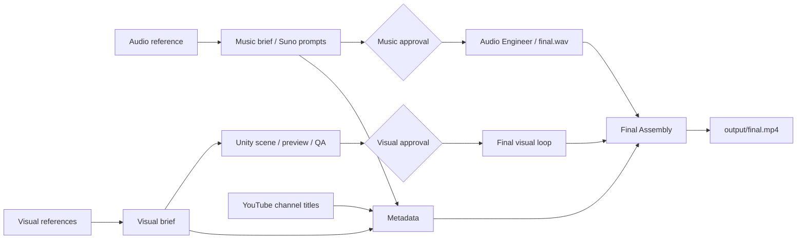

# Liminal Factory — macOS MVP

Локальное приложение Tauri 2 / React / TypeScript с Python sidecar, SQLite, параллельным DAG и ручными утверждениями музыки и визуальной сцены. Полный производственный запуск требует внешних CLI, авторизованного AI-провайдера, YouTube API key и лицензированного Unity с графическим устройством.

## Возможности и статус

| Часть приложения | Что реализовано |
| --- | --- |
| Desktop UI | Dashboard, New Episode, Episodes, Agents, Settings; нативные файловые диалоги |
| Orchestrator | Асинхронный DAG, параллельные ветки, лимит задач, retry/cancel, SQLite и логи |
| Reference intelligence | Разрешённое извлечение аудиофрагмента, измеримый аудиоанализ, image-capable agents, YouTube API pagination/cache |
| Музыка | Suno prompts, ручной импорт, прослушивание, approval с SHA-256, три режима продления |
| Визуал | Агентский JSON scene spec, процедурная Unity-сцена, batch preview/render и Visual QA adapter |
| Экспорт | WAV заданной длительности; H.264/AAC MP4 с проверками FFprobe и контрольным декодированием |
| Упаковка | Tauri `.app` со встроенным Python sidecar; конфигурация `.dmg` |

Проверены запуск `.app` на Apple Silicon, создание эпизода через GUI, восстановление после перезапуска, 24 автоматизированных теста и WAV ровно на 3600 секунд. Полный цикл с реальными Herdr/AI/YouTube/Unity пока не проверен. Результаты и ограничения перечислены в [VERIFICATION.md](VERIFICATION.md), план — в [IMPLEMENTATION_PLAN.md](IMPLEMENTATION_PLAN.md).

## Требования

| Компонент | Для чего нужен | Входит в готовую `.app` |
| --- | --- | --- |
| macOS | Нативный UI, Keychain, запуск Unity | Целевая ОС |
| Node.js 20.19+ и npm | Разработка UI и сборка | Не нужен конечному пользователю |
| Rust stable / Cargo | Сборка Tauri | Не нужен конечному пользователю |
| Python 3.11+ | Разработка backend, PyInstaller | Да, в составе sidecar |
| Xcode Command Line Tools | Компиляция нативной части | Не нужен для запуска готовой сборки |
| FFmpeg / FFprobe | Подготовка аудио, кодирование и проверка видео | Нет |
| yt-dlp | Получение разрешённого аудиофрагмента | Нет |
| Совместимый Herdr TUI CLI | Workspace/pane/agent orchestration | Нет |
| Codex CLI или Gemini CLI | Исполнение AI-задач; требуется авторизация | Нет |
| Unity Editor | Создание сцен и batch render; требуется активная лицензия | Нет |
| YouTube Data API v3 key | Загрузка заголовков канала | Настраивается в Keychain |
| Suno и музыкальный WAV/MP3 | Ручная генерация и импорт музыки | Нет |

Проверенная архитектура — Apple Silicon. Поддержка Intel и других версий macOS требует отдельной сборки и проверки; значение minimumSystemVersion в Tauri само по себе не подтверждает совместимость всех Python/media-зависимостей.

## Быстрый запуск разработки

Все команды выполняйте в Terminal из корня клонированного репозитория. Склонируйте репозиторий:

```bash
git clone https://github.com/IFraimG/liminal-factory.git
cd liminal-factory
```

Проверьте инструменты:

```bash
xcode-select -p
node --version
npm --version
python3 --version
rustc --version
cargo --version
```

Если Command Line Tools отсутствуют:

```bash
xcode-select --install
```

Node.js установите с [nodejs.org](https://nodejs.org/en/download), Python — с [python.org](https://www.python.org/downloads/macos/). Для Rust следуйте [официальной инструкции rustup](https://rustup.rs/). Подробные требования macOS описаны в [документации Tauri](https://v2.tauri.app/start/prerequisites/#macos). Убедитесь, что именно `python3` в PATH имеет версию 3.11 или новее, затем откройте новый Terminal.

Установите JavaScript-зависимости и запустите приложение:

```bash
npm install
npm run tauri dev
```

Первый запуск автоматически создаёт `.venv`, устанавливает Python-зависимости и собирает sidecar. Кэш npm находится внутри `work/`, а не в домашнем каталоге. На машине разработки Rust был установлен в `work/cargo` и `work/rustup`; wrapper использует его, если он существует. На другой машине установите Rust стандартным способом с официального rustup.rs.

```bash
npm run build               # TypeScript и production frontend
npm test                    # реальные проверки backend и коротких FFmpeg media
npm run tauri build         # Python sidecar + release .app и .dmg
```

Для воспроизводимой установки JavaScript-зависимостей после клонирования можно использовать `npm ci` вместо `npm install`.

Для backend-тестов без предварительного GUI-запуска сначала подготовьте Python-окружение:

```bash
python3 scripts/bootstrap.py
npm test
```

`npm run dev` запускает только Vite. Для полноценного приложения используйте `npm run tauri dev`: он запускает native host и Python backend, необходимые для API и файловых диалогов.

## Сборка приложения

```bash
# Полная сборка .app и .dmg
npm run tauri build

# Сборка только .app, если DMG недоступен в текущей среде
npm run tauri build -- --bundles app
```

Ожидаемые результаты:

```text
src-tauri/target/release/bundle/macos/Liminal Factory.app
src-tauri/target/release/bundle/dmg/Liminal Factory_0.1.0_aarch64.dmg
```

Имя/архитектура DMG зависит от машины сборки. Для запуска откройте `Liminal Factory.app` через Finder. При распространении передавайте весь `.app`, сохраняя его внутренние папки и symlink; нельзя переносить один исполняемый файл из `Contents/MacOS`.

Сборки находятся в `src-tauri/target/release/bundle/`. Python включён в приложение через PyInstaller **onedir**, включая numpy, soundfile и нативные библиотеки. Он находится в `Contents/Resources/backend/`; отдельный Python конечному пользователю не нужен. One-file намеренно не используется: его semaphore/extraction механизм запрещён в среде разработки. FFmpeg, FFprobe, yt-dlp, Herdr, Codex/Gemini и Unity являются проверяемыми внешними prerequisite и в приложение не включены.

## Настройка внешних компонентов

### FFmpeg и yt-dlp

Установите [FFmpeg](https://ffmpeg.org/download.html) и [yt-dlp](https://github.com/yt-dlp/yt-dlp#installation) по их официальным инструкциям. Убедитесь, что доступны три команды:

```bash
ffmpeg -version
ffprobe -version
yt-dlp --version
```

В Settings → External Tools задаются пути именно к executable, а не к папке. Если программа работает в Terminal, но не обнаруживается в `.app`, укажите абсолютный путь из `command -v ffmpeg`, `command -v ffprobe` и `command -v yt-dlp`.

### Herdr TUI

Установка через уже настроенный Homebrew согласно [официальной инструкции Herdr](https://herdr.dev/tui/docs/install/):

```bash
brew install herdr
herdr --version
herdr agent start --help
```

Если используете другой способ установки, следуйте официальной инструкции. До запуска production откройте Herdr либо запустите его server в отдельном Terminal:

```bash
herdr server
```

Оставьте его запущенным и из другого Terminal проверьте:

```bash
herdr status
herdr agent list
```

Старый/несовместимый CLI не подходит только на основании похожего названия. Liminal Factory проверяет доступные команды перед запуском.

### AI-провайдер

Установите и авторизуйте выбранный Codex либо Gemini CLI по документации его поставщика. Проверьте `codex --version` или `gemini --version`, затем вручную убедитесь в доступности нужной модели. В приложении задайте agent kind, default model и при необходимости model mapping для отдельных задач. Флажок vision включайте только после проверки, что агент действительно умеет открывать изображения с диска.

### YouTube API

1. Откройте [Google Cloud Console](https://console.cloud.google.com/), выберите либо создайте проект.
2. В API Library включите **YouTube Data API v3**.
3. Создайте API key в Credentials и ограничьте его доступом к YouTube Data API v3.
4. Вставьте ключ в Settings → YouTube → API key и нажмите **Save to Keychain**.
5. Не добавляйте ключ в `.env`, README, issue или Git. Он не нужен для сборки приложения.

При отсутствии ключа Start Production возвращает понятную ошибку. На этапе анализа каналов заголовки читаются из публичной uploads playlist. Кэш задаётся в часах; значение 0 отключает повторное использование ранее полученных данных.

### Unity

Установите Unity Editor через [Unity Hub](https://unity.com/download), активируйте подходящую лицензию и откройте Editor хотя бы один раз, чтобы завершить настройку. На машине разработки установлен Unity 6000.6.5f1; другие версии требуют проверки.

В Settings укажите путь вида:

```text
/Applications/Unity/Hub/Editor/<VERSION>/Unity.app/Contents/MacOS/Unity
```

Test Connection подтверждает наличие executable. Работоспособность лицензии и графики проверяется настоящим batch render. При лицензировании/compile/graphics errors задача будет Failed; смотрите `unity-create.log`, `unity-preview.log` и `unity-render.log` внутри папки эпизода.

### Первоначальная настройка в приложении


1. Откройте Settings, выберите отдельную директорию проектов и сохраните настройки.
2. Настройте пути внешних инструментов и нажмите Test Connection для каждого. Unity автоматически ищется в `/Applications/Unity/Hub/Editor/*/Unity.app/Contents/MacOS/Unity`.
3. Установите **Herdr TUI CLI** из официальной документации. Наличие приложения `Herdr.app` либо другого исполняемого файла `hc` не подтверждает совместимость. Требуются команды `workspace create`, `agent start --kind … --pane …`, `agent prompt/get/read/send-keys` и `pane close`. Запустите Herdr server самостоятельно согласно его документации. Приложение не перезапускает чужие сессии.
4. Авторизуйте Codex либо Gemini в их терминальном CLI. Выберите kind и идентификатор модели; для отдельных задач можно переопределить модель. Herdr использует каноническое имя executable. Директория настроенного CLI передаётся в PATH новой workspace; имя файла должно быть `codex`/`gemini`.
5. Убедитесь, что выбранный agent/model действительно умеет просматривать локальные изображения, и включите соответствующий флажок. Без этого visual analysis недоступен и production не начнётся.
6. В Google Cloud включите YouTube Data API v3, создайте и ограничьте ключ этим API. Сохраните его в Settings → YouTube. Он хранится только в нативном macOS Keychain (Security framework через keyring macOS backend).
7. Активируйте Unity Personal/Pro в Unity Hub. Нужен работающий графический рендеринг. `-nographics` не используется и не подходит для захвата кадров.

## Производство эпизода

- New Episode: HTTPS YouTube video URL, начало MM:SS/HH:MM:SS, длительность анализа, согласие на получение фрагмента, одно или несколько изображений, канал `/@handle` либо `/channel/UC…`.
- Изображения поддерживают drag and drop, миниатюры, порядок и удаление. Они копируются в workspace. После начала анализа references блокируются.
- Выберите стиль, длительность, FPS, разрешение, audio mode, длину визуальной петли и при желании директорию экспорта. Save episode draft сохраняет эпизод без запуска внешних задач. Start Production проверяет зависимости и запускает DAG.
- Audio Reference и Visual Reference одновременно с Channel Reference выполняют независимые работы. Semaphore ограничивает общее число активных задач; это также ограничивает число агентов.
- Audio analysis использует фактические RMS, FFT spectral centroid, динамический диапазон и оценку темпа по autocorrelation. Это **не** семантическое прослушивание моделью; для ambient оценка темпа может быть ненадёжной. Ограничения записываются в JSON.
- Music Agent создаёт оригинальный бриф и несколько Suno prompts. Их можно редактировать, сохранять и копировать. Open Suno открывает официальный сайт. Генерируйте музыку вручную и импортируйте WAV/MP3. Автоматизации браузера Suno нет.
- Approve music фиксирует SHA-256 музыки и брифа. Следующая задача автоматически собирает WAV заданной длительности.
- Visual Agent реально просматривает изображения через настроенный CLI. Unity Agent выбирает ограниченный JSON scene spec: палитру, туман, камеру, шаг колонн. Фиксированный C# template создаёт terrain, архитектуру, материалы, свет, fog, камеру и периодическое движение. Произвольный C# от модели не исполняется.
- Unity создаёт preview; image-capable agent сравнивает первый кадр с references и сохраняет Visual QA. После Approve visual сцена рендерит петлю в целевом разрешении, затем FFmpeg собирает MP4.
- Metadata ждёт музыкального и визуального брифов, получает все доступные публичные заголовки из uploads playlist с pagination/cache, создаёт пять уникальных заголовков, описание и хэштеги. Проверяется формат `#tag, #tag` и отсутствие дословных совпадений с источниками. Прогноз эффективности не заявляется.
- Final Assembly ждёт все ветки. Результат — `output/final.mp4` и `output/metadata.json`. Дополнительный экспорт создаёт уникальную папку `liminal-<episode-id>` без перезаписи существующей.

В Episode Details доступны реальные статусы, время задач, structured results, логи, playable audio/video, файлы, Retry Task, Cancel Task, Approve, Request Changes и Open Output Folder. Request Changes передаёт текст агенту и инвалидирует зависимые задачи, включая metadata/final assembly. Музыку можно удалить и импортировать заново до утверждения.

## Аудио и видео

Seamless Loop ищет тихие окна у границ, делает перекрытие tail/head и записывает повторяемый cycle на диск. Финальный WAV не создаётся целиком в памяти. FFmpeg повторяет его до нужной длительности; two-pass loudnorm целится в -18 LUFS / -1.5 dBTP. Финальный проход измеряет true peak, sample peak и точную длительность. Слишком тихий/некорректный источник отклоняется.

Ambient Evolution добавляет отдельную детерминированную плавную амплитудную вариацию до 2.5% с периодом 125 секунд. Multi-track сначала сшивает несколько утверждённых файлов через crossfade и затем строит петлю. Это минимальные, предсказуемые преобразования; сложной генеративной аранжировки в MVP нет.

Unity снимает кадры в batchmode через Camera.Render/RenderTexture. Все движения определяются фазой одного периода и не накапливают время. C# сохраняет сцену `unity-project/Assets/Liminal.unity`, которую можно открыть в Editor. Требуется лицензия и графический device; ошибка возвращается явно с Unity log.

FFmpeg повторяет короткий визуальный цикл, кодирует H.264/AAC с требуемым FPS/разрешением, затем FFprobe проверяет streams/codecs/duration/resolution/FPS, а FFmpeg декодирует начало, середину и конец файла. Час уникальных кадров не рендерится.

## Как выполняется DAG



Failed-задача блокирует зависимых потребителей. Retry повторяет выбранную неуспешную/отменённую задачу после успешного завершения её dependencies. Cancel останавливает текущую process group либо созданный агентский pane. Approve доступен только в Waiting for Approval. Request Changes сбрасывает зависимые результаты и сохраняет текст правок для следующей попытки агента.

## Надёжность и безопасность

- Loopback HTTP на случайном порту; два UUID формируют bearer token. Токен передаётся sidecar через environment, а webview — через единственную Rust bootstrap command. CORS/CSP ограничивают источники. Media range requests поддерживаются FileResponse; для тегов audio/video используется token URL, access logs выключены.
- В JavaScript нет shell/filesystem capabilities. Нативным диалогам разрешён только выбор файлов/каталогов. Rust-команда открытия сайта фиксирована на Suno, backend открывает только папку существующего эпизода.
- subprocess вызывается списком аргументов без shell; процессы имеют отдельную process group, timeout и рекурсивную отмену. Секреты не передаются в CLI аргументах и не сохраняются в логах.
- Строгий HTTPS/YouTube whitelist, защита от path traversal и symlink escape, проверка содержимого изображений/аудио, ограничения импорта 70 MB и 40 MP.
- Reference data не считаются инструкциями. Модели получают явную политику; код сцены фиксирован, их JSON проходит Pydantic validation. Автоматической публикации нет.
- SQL WAL хранит состояния, identity pane/agent, артефакты и structured logs. Backend lock исключает два orchestrator для одной data folder.
- После перезапуска прерванные локальные операции переходят в Failed с требованием Retry. Сохранённые Herdr identity сверяются с CLI; проверяемый агент останавливается перед повтором. Произвольный сохранённый PID не используется для kill. Если Herdr недоступен, интерфейс требует ручной проверки. Это безопасное восстановление к явному повтору, а не продолжение прерванного FFmpeg с середины.
- Каждая попытка агента имеет уникальный результат JSON. `idle`/`done` без валидного файла не считаются успехом. Approved-файлы повторно проверяются по SHA-256 перед обработкой/сборкой.
- Мок Herdr существует только как test dependency; production UI не может выбрать его.

## Данные

По умолчанию: `~/Library/Application Support/Liminal Factory/factory.sqlite3`; эпизоды находятся в подпапке `episodes/`. Путь проектов задаётся до создания первого эпизода. Смена root при существующих эпизодах блокируется, чтобы не терять связь с файлами. Для изолированной проверки можно перед запуском задать `LIMINAL_DATA="$PWD/work/runtime"`.

```text
backend/                  API, schemas, SQLite, DAG, adapters, media
src/                      React UI, typed API, navigation, styles
src-tauri/                native host, minimal capabilities, packaging
unity-template/           reproducible C# procedural scene
scripts/                  bootstrap, PyInstaller build, hour stress test
tests/                    security, DAG, API, Herdr contract, actual FFmpeg
IMPLEMENTATION_PLAN.md    implementation / validation checklist
VERIFICATION.md           observed checks and outstanding prerequisites
```

## Тестирование и диагностика

```bash
# Backend, DAG, API, безопасность и реальные короткие media-проверки
python3 scripts/bootstrap.py
npm test

# TypeScript и production frontend
npm run build

# Дополнительная реальная проверка часового WAV
.venv/bin/python scripts/verify_hour_audio.py
```

Часовой stress test использует синтетические тоны, создаёт временный WAV примерно на гигабайт в `work/hour-audio-test`, проверяет его и удаляет после успешного завершения. Это тест обработки, а не сгенерированная музыка и не полный production episode. FFmpeg должен быть доступен в PATH; без него media-тесты помечаются skipped, поэтому проверяйте итоговый отчёт pytest.

| Проблема | Что проверить |
| --- | --- |
| `cargo` / `rustc` not found | Rust установлен; новый Terminal загружает PATH; `cargo --version` работает |
| Python ниже 3.11 | Путь `command -v python3` и `python3 --version`; окружение создаётся этим интерпретатором |
| `.venv/bin/python` not found | Выполните `python3 scripts/bootstrap.py` из корня проекта |
| Backend is not connected | Открывайте приложение через Tauri, а не отдельную страницу Vite; изучите stderr Terminal |
| Backend did not initialize in 30 seconds | Убедитесь, что sidecar полностью упакован и доступна data folder; проверьте запуск из Terminal |
| Workspace already open | Закройте другой экземпляр, использующий ту же data folder; не удаляйте lock у работающего процесса |
| Herdr missing/incompatible | Проверьте TUI CLI, `herdr agent start --help`, server и абсолютный executable path |
| Agent blocked | Откройте его pane в Herdr, разберите запрос авторизации/доверия и повторите задачу; приложение не подтверждает диалоги за вас |
| Нет `music_brief.json` / structured result | Agent idle не означает успех: требуется валидный результат; проверьте agent log, модель и доступ к workspace |
| YouTube API key missing / HTTP 403 | Ключ в Keychain, API включён, ограничения ключа и quota корректны |
| yt-dlp download error | URL, доступность материала и разрешение; защищённый/недоступный материал не обходится |
| Visual analysis unavailable | Image-capable model/CLI, локальный просмотр файлов и флажок vision |
| Unity license/graphics error | Unity Hub license, первый ручной запуск Editor, работающая графическая среда; не добавляйте `-nographics` |
| Approved artifact changed | Файл изменён после approval; верните исходный результат или запросите изменения и утвердите повторно |
| Multi-track требует два файла | Импортируйте минимум два WAV/MP3 перед Approve music |
| `hdiutil: Device not configured` | Соберите `.app` через `npm run tauri build -- --bundles app`; DMG собирайте в macOS-среде с доступной disk image subsystem |
| Не хватает места | WAV, Unity project, PNG-кадры и итоговое видео хранятся на диске; выберите рабочую папку с достаточным свободным объёмом |

Для изолированной сессии разработки:

```bash
LIMINAL_DATA="$PWD/work/local-session" npm run tauri dev
```

Используйте другой LIMINAL_DATA, если production `.app` уже открыта: один data folder обслуживается одним backend. Перед backup закройте приложение и скопируйте целиком data folder вместе с папкой эпизодов; ключи остаются в Keychain.

## Что хранится в Git

В репозиторий входят исходники, lock-файлы npm/Cargo, конфигурация Tauri, Unity C# template, тесты и документация. `.venv`, `node_modules`, `work`, `outputs`, `src-tauri/target`, упакованный sidecar, локальные базы и сгенерированные медиа не нужны для исходников и не публикуются. Код автоматически не открывает доступ к проектным файлам другим пользователям и не публикует готовые видео.

## Ограничения текущей версии

Нет гарантий semantic audio understanding, расширенной генерации Unity-кода, автоматического Suno, публикации на YouTube, частичного resume render, агента без авторизации или работы без внешних инструментов. Appearance фиксирован в dark mode; output defaults задаются в форме эпизода. Режим preview — та же процедура с меньшим разрешением. Модель может предложить visual QA правки, но их применение требует Request Changes и нового scene spec. Изображения обрабатываются внешним модельным провайдером только при явном запуске производства.

Локальная сборка не равна production distribution. Для распространения нужны Apple Developer signing/notarization, проверка лицензий внешних компонентов и тесты на целевых Intel/Apple Silicon машинах. Текущая сборка предназначена для этой Apple Silicon macOS-среды.

## Официальная документация

- [Herdr agent automation](https://herdr.dev/tui/docs/agent-automation/) и [CLI reference](https://herdr.dev/tui/docs/cli-reference/)
- [Tauri 2 — external binaries](https://v2.tauri.app/develop/sidecar/) и [resources](https://v2.tauri.app/develop/resources/)
- [YouTube playlistItems.list](https://developers.google.com/youtube/data/reference/rest/v3/playlistItems/list)
